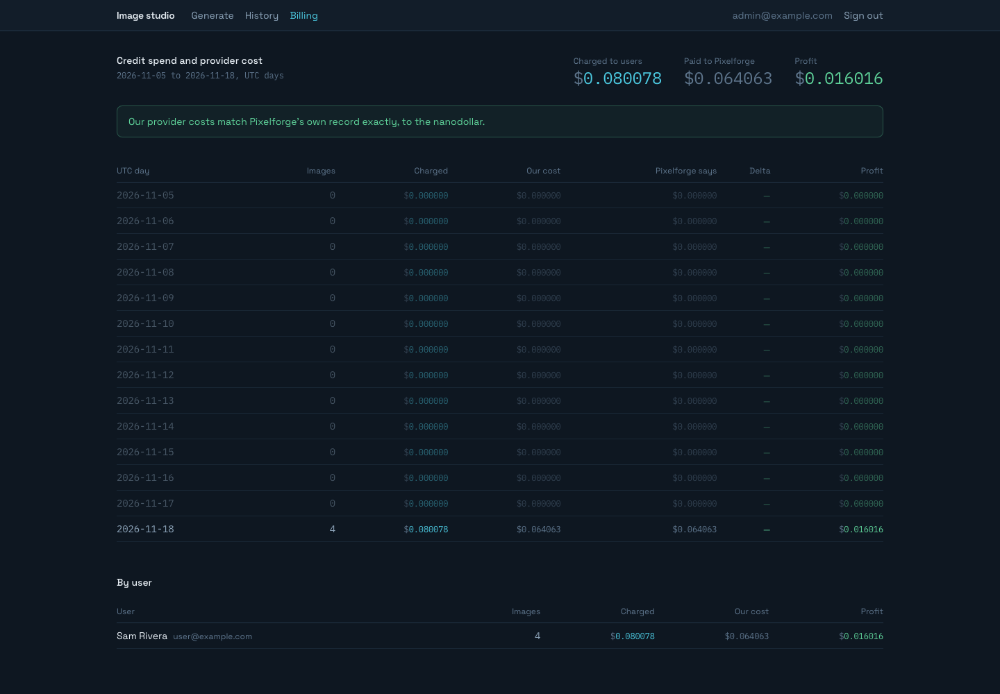

# Image Studio

Generate images through [Pixelforge](https://pixelforge.promptedit.dev/) and
record what each one costs.

Laravel 13, Vue 3, Inertia 2, Tailwind 4, Pest, Playwright.


## What it does

Users write a prompt, pick a size and quality, and see the cost before they
commit. The app sends the request to Pixelforge, tracks it through webhooks and
polling, and charges Pixelforge's cost plus 25% once the generation settles.
Failed generations cost nothing.

Generations are asynchronous and priced per token, and some of those tokens are
only counted after the work finishes. So most of the code here is about getting
the accounting right when the answer arrives late, twice, out of order, or not
at all.

## How the money works

**Integers, not decimals.** Pixelforge reports costs as nine-decimal strings
like `0.011707500`, so the app stores everything in nanodollars (1 USD = 10^9).
Rates are dollars per million tokens at two decimal places, which makes
nanodollars-per-token `rate × 1000` — always whole. Those values are all
divisible by 4, so the 25% markup (×5/4) stays whole as well. `Money` is the
only money type, and `Money::withMarkup()` throws rather than round if a future
rate ever breaks that assumption.

Checked against the live API: usage of `{9, 0, 280, 37}` tokens works out to
11,707,500nd, or `$0.011707500`, which is what `GET /v1/usage` returned for the
same generation.

**The up-front price is a range.** Output and reference-image tokens are known
before the run. Input text varies by about 15%, and reasoning tokens are only
counted at the end — on `high` quality that band is worth about $0.0875 on its
own, more than the rest of a typical generation. Showing a single number would
be presenting a guess as a fact, so the UI shows the expected cost with its
bounds. Credit is reserved against the top of the range, which is what stops
someone with a thin balance overdrawing when reasoning comes in high.

## How duplicate and double charges are prevented

Two unique indexes do the real work:

```
webhook_events       UNIQUE (event_id)
credit_transactions  UNIQUE (generation_id, type)
```

A redelivered webhook fails to insert and gets a `200` anyway. A second charge
against a generation cannot be written at all. These are constraints rather than
application checks, so they hold under concurrency. `pixelforge:verify-ledger`
re-checks that cached balances still match the ledger.

One class, `ApplyProviderState`, is the only thing that changes a generation's
status or settles money. The webhook handler, the submit job and the reconciler
all call it, so they cannot disagree. Transitions are monotonic: a
`generation.processing` redelivered after `generation.succeeded` is ignored.

Each generation gets one idempotency key, written to the database before
anything is sent. Every retry reuses it and rebuilds the payload from the stored
row rather than from request input, so the parameters are always byte-identical
and a `409 idempotency_key_reused` cannot happen.

## Failure handling

| Pixelforge returns | What happens |
|---|---|
| `429 rate_limit_exceeded` | release for the `Retry-After` interval |
| `429 concurrency_limit_exceeded` | usually avoided; the in-flight gate runs first |
| `429 daily_limit_exceeded` | give up now — retrying only burns rate limit |
| `503 overloaded` | release for `Retry-After`, exponential backoff with jitter |
| `400`, `422`, `409` | terminal, hold released, nothing billed |
| timeout, outcome unknown | retry with the same key, **hold kept** |
| failure after accept | terminal, nothing billed, hold released |
| duplicate webhook | unique index; one record, one charge |
| out-of-order webhook | monotonic guard; a final state never reopens |
| webhook before the create response | matched on `metadata.generation_id` |
| webhook never arrives | the reconciler polls and settles it |

### When we can't tell whether the request arrived

A timeout is the awkward case: Pixelforge may or may not have created a billable
generation. The app marks these `unknown`, keeps the credit hold, and replays the
idempotency key. Replays are safe, since a key the provider has already seen
returns the same generation rather than making another.

If replays run for an hour without an answer, automatic retries stop and the
generation becomes `unresolved` — still holding the credit, waiting for a person.
It is deliberately not recorded as a failure, because we don't know that it
failed, and releasing the hold would hand back credit we might owe Pixelforge
for.

An operator picks it up from there:

```bash
php artisan pixelforge:resolve-generation           # what's waiting
php artisan pixelforge:resolve-generation <id>      # inspect; read-only
```

Inspection matters because of a detail in the Pixelforge docs: an idempotency
key only replays if the provider received the original request. If it never
arrived, sending the key again **creates a new generation and bills for it**. So
re-sending sits behind an explicit `--submit`, and the default is a read-only
lookup through `GET /v1/generations`, matched on the id the app puts in
`metadata`. Releasing a hold runs that same check first and refuses if the
generation turns up.

`docs/ENGINEERING.md` has the full runbook, including what evidence is needed
before releasing a hold.

### One thing that is advisory, not enforced

The app tracks how many generations are in flight and holds new submissions when
it reaches `PIXELFORGE_MAX_IN_FLIGHT`. That count is an unsynchronised read, so
workers starting at the same moment can all pass it — eight parallel workers
against a cap of three all went through when measured. It reduces pressure but
does not enforce a limit. Pixelforge's own 429 is the real limit, and the submit
job honours its `Retry-After`.

What *is* exact is the per-generation attempt claim: one conditional `UPDATE`,
so only one worker can be submitting a given generation at a time. Twelve
parallel workers competing for one generation produced one claim.
`tests/concurrency/run.sh` reproduces both numbers.

## Running it

```bash
composer install && npm install
cp .env.example .env && php artisan key:generate
touch database/database.sqlite
php artisan migrate --seed
npm run build
```

Three processes, not one:

```bash
php artisan serve           # the app
php artisan queue:work      # submissions run here
php artisan schedule:work   # reconciliation, every minute
```

Skipping the scheduler means nothing recovers a generation whose webhook goes
missing, and nothing sweeps unresolved ones.

Fill in `.env` (see [DEPLOY.md](DEPLOY.md) for where the values come from):

```dotenv
PIXELFORGE_API_KEY=pf_…
PIXELFORGE_WEBHOOK_SECRET=whsec_…
```

Use one API key per environment. Keys have separate webhook secrets and separate
`GET /v1/usage` reports, so sharing one between local and production makes the
billing report impossible to reconcile.

Seeded accounts, password `password`:

| Email | What it's for |
|---|---|
| `admin@example.com` | operator, sees the billing report, $20 |
| `user@example.com` | ordinary user, $5 |
| `broke@example.com` | no credit, for the "can't afford it" path |

Webhooks need a public URL. Locally:

```bash
cloudflared tunnel --url http://127.0.0.1:8000
# then put <tunnel>/webhooks/pixelforge on the key in the Pixelforge dashboard
```

## Tests

```bash
./vendor/bin/pest                                      # 220 tests, 748 assertions
npx playwright test --project=ui                       # 42 browser tests
PIXELFORGE_LIVE=1 npx playwright test --project=live   # against the real API
php artisan pixelforge:verify-ledger                   # checks the money adds up
tests/concurrency/run.sh                               # parallel workers; opt-in, slow
```

The live suite needs a real key, a running worker and a tunnel taking webhooks.
[docs/VERIFICATION.md](docs/VERIFICATION.md) records what was checked against the
real API as opposed to covered by automated tests.

The concurrency harness spawns real OS processes against a shared SQLite file.
It's too slow and too environment-dependent for CI, so it isn't in the Pest
suite.

## Layout

```
app/
  Pixelforge/        Money, Rates, TokenUsage, PricingEngine, HTTP client,
                     webhook signatures — everything touching the provider
  Actions/           ApplyProviderState (only writer of status and money),
                     LedgerWriter (only writer of the ledger), CreateGeneration
  Jobs/              SubmitGeneration, ResolveUnknownGeneration
  Reporting/         BillingReport, reconciled against GET /v1/usage
  Console/Commands/  pixelforge:reconcile, :verify-ledger, :resolve-generation
resources/js/
  Components/        MoneyFigure, CostBand, StatusPill, Pagination, …
  Pages/             Generations/Create, Generations/Index, Admin/Report
docs/DESIGN.md       the design this was built from
docs/ENGINEERING.md  invariants, recovery paths, operator runbook
```

## Interface notes

Colour carries meaning rather than decoration. Amber is a figure we don't know
yet, cyan is one Pixelforge has settled, and neither hue is used for anything
else — so an amber number always means "still an estimate".

Money is set in IBM Plex Mono with tabular figures so the digits line up
vertically. The reconciliation table exists to compare `0.011707500` against
`0.011707501`, which is unreadable in a proportional face.


