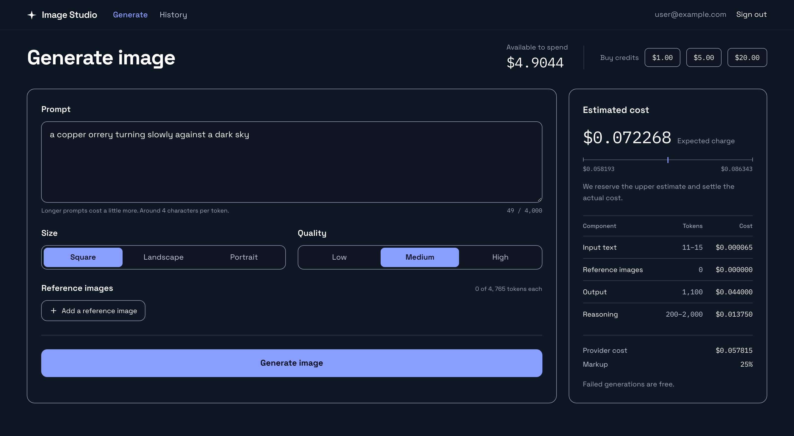

# Image Studio

Generate images through [Pixelforge](https://pixelforge.promptedit.dev/), and
record exactly what each one costs.

Laravel 13 · Vue 3 · Inertia 2 · Tailwind 4 · Pest · Playwright



---

## What this is

Users write a prompt, pick a size and quality, and see what it will cost before
they commit. The app submits the request to Pixelforge, follows it through
webhooks and polling, and charges the user Pixelforge's cost plus 25% — once,
exactly, and never for a generation that failed.

The hard part isn't generating images. It's that generations are asynchronous,
priced per token, partly unknowable up front, and delivered by a provider that
deliberately misbehaves. So the design optimises for one thing: **the money is
provably right, because the database makes wrongness unrepresentable.**

## The five decisions worth knowing

### 1. Money is integer nanodollars, end to end

Pixelforge reports money as an exact nine-decimal string (`"0.011707500"`) and
the docs recommend integers. One nanodollar is therefore the natural atom.

A rate is dollars-per-1M-tokens at two decimal places, so nanodollars per token
is `rate × 1000` — always a whole number (`$12.50 → 12,500nd`). Every such value
is divisible by 4, so the ×5/4 markup stays integral too. No float or decimal
string arithmetic touches the money path, and `Money::withMarkup()` throws rather
than round if a future rate ever broke that.

Verified against the live API: usage `{9, 0, 280, 37}` → `11,707,500nd` →
`$0.011707500`, which is byte-for-byte what `GET /v1/usage` reported.

### 2. The price shown up front is a range, not a number

Output and reference-image tokens are exact before a generation runs. Input text
carries ±15% variance, and reasoning is only counted at completion — for `high`
quality that band alone spans $0.0875, more than the rest of a typical
generation. A single "estimated cost" would be a guess presented as a fact, so
the UI shows the expected figure with the real bounds beside it.

Credits are reserved against the **maximum**, which is what stops a user with a
thin balance overdrawing when reasoning lands above the midpoint.

### 3. One idempotency key, persisted before the first request

Every generation is created locally in `pending` with its idempotency key
committed *before* anything is sent to Pixelforge. Every attempt — including
after a timeout whose outcome we cannot know — reuses that key and sends
byte-identical parameters (always rebuilt from the stored row, never from
request input, so a `409` is impossible by construction).

That single fact is what makes retrying a submission safe.

### 4. Deduplication and single-charge are database invariants

```
webhook_events      UNIQUE (event_id)
credit_transactions UNIQUE (generation_id, type)
```

A redelivered event fails to insert, which we catch and answer `200`. A second
charge against a generation cannot be written at all. These are not application
checks that could race — they are constraints, and `pixelforge:verify-ledger`
asserts they still hold.

On top of that, a single action (`ApplyProviderState`) is the **only** code that
changes a generation's status or settles money. The webhook handler, the submit
job's create response, and the reconciler's poll all go through it, so they
cannot reach different conclusions. It applies transitions monotonically, so a
retried `generation.processing` arriving after `generation.succeeded` is ignored.

### 5. The provider's in-flight cap is tracked separately from worker concurrency

Pixelforge allows 3 generations queued-or-processing **per account**. A submit
job finishes in ~200ms while its generation stays in flight for 5–30 seconds, so
worker concurrency is no proxy for provider capacity. The gate counts our own
in-flight generations and releases the job for 5 seconds when at the cap —
and crucially, waiting for capacity does **not** consume retry budget.

## When things go wrong

| Pixelforge does | The app does |
|---|---|
| `429 rate_limit_exceeded` | releases for exactly the `Retry-After` seconds |
| `429 concurrency_limit_exceeded` | gated before the call, so rarely provoked |
| `429 daily_limit_exceeded` | gives up immediately; retrying only burns the rate limit |
| `503 overloaded` | releases for `Retry-After`, exponential backoff with jitter |
| `400` / `422` / `409` | terminal; hold released, nothing billed |
| timeout, unknown outcome | retries with the same key; **hold is kept** |
| `[fail]` after accept | terminal, charged nothing, hold released |
| webhook twice | unique index; one record, one charge |
| webhook out of order | monotonic guard; a final state never reopens |
| webhook before create returns | matched via `metadata.generation_id` |
| webhook never arrives | reconciler polls and settles it |

### The genuinely dangerous case

If the submit retry budget runs out while the outcome is still **unknown** — a
timeout, where Pixelforge may or may not have created a billable generation — the
generation is parked as `unknown` and **the credit hold is deliberately kept**.
Releasing it could let a user spend credits we may still owe the provider for.

`ResolveUnknownGeneration` then replays the idempotent create. The contract
guarantees this either returns the existing generation (adopt it, bill correctly)
or creates it once — never bills twice. If a bounded window closes without an
answer, the app fails closed: releases the hold, tells the user plainly they were
not charged, and logs loudly. The billing report then surfaces any provider cost
we failed to record, so the gap is visible rather than silent.

## Running it

```bash
composer install && npm install
cp .env.example .env && php artisan key:generate
touch database/database.sqlite
php artisan migrate --seed          # creates the demo accounts below
npm run build

php artisan serve                   # the app
php artisan queue:work              # REQUIRED: submissions run on the queue
php artisan schedule:work           # REQUIRED: reconciliation runs every minute
```

Set these in `.env` (see [DEPLOY.md](DEPLOY.md) for where the values come from):

```dotenv
PIXELFORGE_API_KEY=pf_…
PIXELFORGE_WEBHOOK_SECRET=whsec_…
```

Demo accounts (password `password`):

| Email | Role |
|---|---|
| `admin@example.com` | operator — can see the billing report |
| `user@example.com` | ordinary user, $5 credit |
| `broke@example.com` | no credit, for the "cannot afford" path |

**Webhooks need a public URL.** For local development:

```bash
cloudflared tunnel --url http://127.0.0.1:8000
# then paste <tunnel>/webhooks/pixelforge into the key's row in the dashboard
```

## Tests

```bash
./vendor/bin/pest                       # 157 tests, 497 assertions
npx playwright test --project=ui        # 13 browser tests
PIXELFORGE_LIVE=1 npx playwright test --project=live   # against the real API
php artisan pixelforge:verify-ledger    # proves the money still adds up
```

The live suite needs a real key, a running worker, and a tunnel receiving
webhooks. See [docs/VERIFICATION.md](docs/VERIFICATION.md) for exactly what was
verified against the real API versus what is covered by automated tests.

## Layout

```
app/
  Pixelforge/        Money, Rates, TokenUsage, PricingEngine, the HTTP client,
                     webhook signature verification — the provider boundary
  Actions/           ApplyProviderState (the only state/money mutation),
                     LedgerWriter (the only ledger writer), CreateGeneration
  Jobs/              SubmitGeneration, ResolveUnknownGeneration
  Reporting/         BillingReport — reconciliation against GET /v1/usage
  Console/Commands/  pixelforge:reconcile, pixelforge:verify-ledger
resources/js/
  Components/        MoneyFigure, CostBand, CostBreakdown, StatusPill, …
  Pages/             Generations/Create, Generations/Index, Admin/Report
docs/DESIGN.md       the design this was built from
docs/ENGINEERING.md  invariants, recovery paths, operator runbook
```

## Design notes

The interface treats colour as meaning rather than decoration: **amber is a
figure we don't know yet, cyan is one Pixelforge has settled**. Those two hues
appear nowhere else, so an amber number always means "still an estimate".

Money is set in IBM Plex Mono with tabular figures — not as a stylistic tic, but
because the reconciliation table compares `0.011707500` against `0.011707501`
and the digits have to align vertically to be comparable at all.


